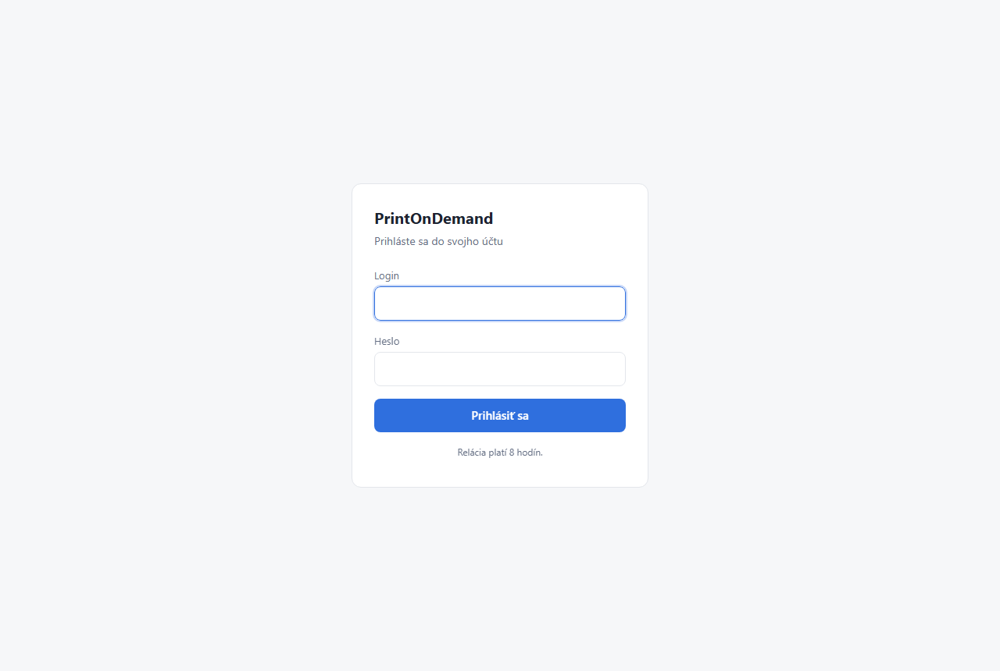
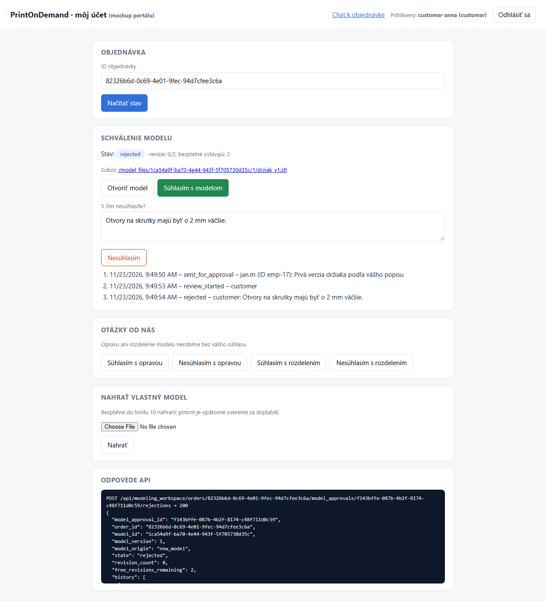
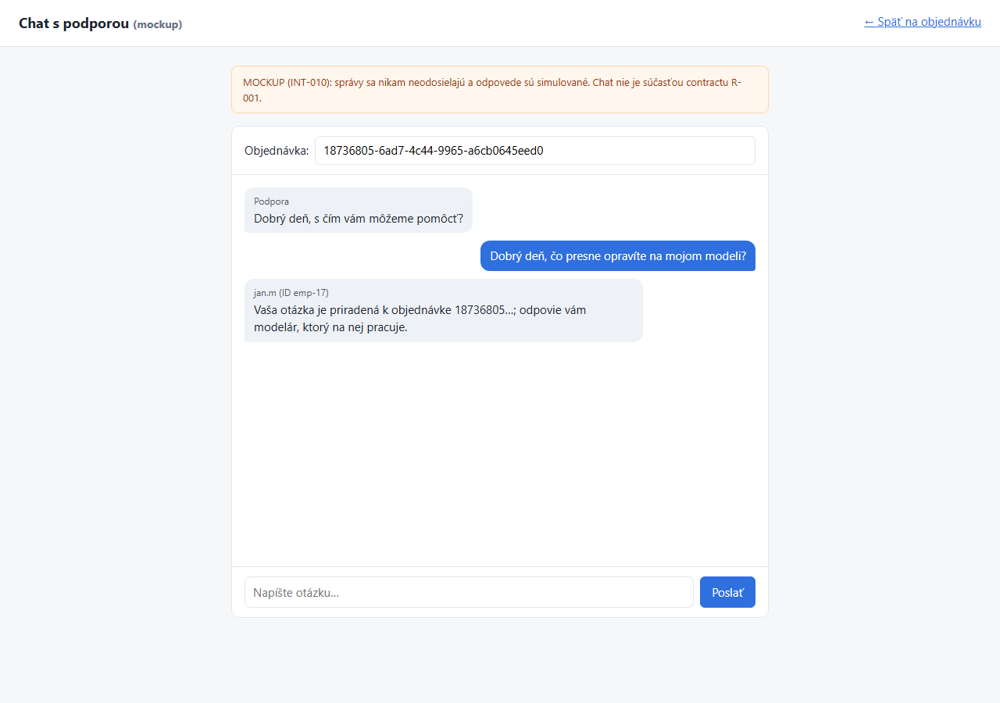

# Demo – schválenie 3D modelu zákazníkom (mockup)

Ukážka funkcionality **R-001 „3D model approval (2 free revisions)“** pre
PrintOnDemand: zákazník sa prihlási do portálu, pozrie si 3D model, ktorý pre
neho vytvoril náš modelár, a model schváli alebo s ním nesúhlasí s komentárom.

> **Toto je mockup.** Portál a chat sú jednoduché statické stránky na ukážku.
> Backend (API, pravidlá, databáza) je skutočný a pokrytý testami, ale reálne
> 3D tlačiarne, slicer, e-mail ani SMS nie sú pripojené. Validátor modelu je
> zástupný (stub).



## Čo ukážka predvádza

| Pravidlo | Čo uvidíte |
|---|---|
| Do tlače ide iba model so súhlasom zákazníka (PRIN-001, BR-001) | model sa tlačí až po kliknutí „Súhlasím s modelom“ |
| O schválení rozhoduje iba zákazník (BR-003) | tlačidlá súhlasu má iba zákazník; modelár za neho rozhodnúť nemôže |
| Nesúhlas vždy s komentárom (BR-003) | bez komentára sa nesúhlas neodošle |
| 2 bezplatné revízie (BR-002) | počítadlo „revízie: x/2, bezplatné ostávajú: y“ |
| Oprava iba so súhlasom zákazníka (BR-005) | Boris dostane otázku, či má jeho model opraviť |
| Zákazník vidí ID a prezývku zamestnanca, nie celé meno (QR-001) | v histórii „jan.m (ID emp-17)“ |
| Prihlásenie loginom a heslom, relácia 8 h v HttpOnly cookie (QR-002) | prihlasovacia stránka, tlačidlo „Odhlásiť sa“ |

## Spustenie

Potrebné: Docker Desktop (zapnutý), Python 3.12. Príkazy sa spúšťajú
z koreňa repozitára v Git Bash.

**1. Prvýkrát – inštalácia**

```bash
python -m venv .venv
.venv/Scripts/pip install -e ".[test]"
```

**2. Databáza**

```bash
docker compose up -d
```

**3. Server** (nechaj bežať v samostatnom termináli)

```bash
PYTHONPATH=src .venv/Scripts/uvicorn pod.main:create_app --factory
```

**4. Dáta na ukážku** (v druhom termináli)

```bash
PYTHONPATH=src .venv/Scripts/python -m pod.demo
```

Skript vypíše dve čísla objednávok, napríklad:

```
Ukážka je pripravená:  http://127.0.0.1:8000/portal/

  anna  / Anna-heslo-1   objednávka a5183f97-…  (model čaká na schválenie)
  boris / Boris-heslo-1  objednávka 3c672dea-…  (model má chybu, čaká sa na súhlas s opravou)
```

Pred každou ďalšou ukážkou stačí znova spustiť krok 4 – vzniknú nové objednávky.

## Scenár ukážky (cca 3 minúty)

### 1. Prihlásenie

1. Otvor **http://127.0.0.1:8000/portal/** – presmeruje na prihlásenie.
2. Najprv zadaj zlé heslo (`anna` / `zle-heslo`) → „Nesprávny login alebo heslo.“
   Systém nepovie, či bol zlý login alebo heslo.
3. Prihlás sa: **`anna` / `Anna-heslo-1`**.

### 2. Anna schvaľuje model (VAR-1 – model vytvoril náš modelár)

1. Do poľa **ID objednávky** vlož číslo Anninej objednávky a klikni **Načítať stav**
   → stav `waiting_for_review`, v histórii modelár `jan.m (ID emp-17)`.
2. **Otvoriť model** → stav `in_review` (modelár vidí, že si ho zákazník pozrel),
   zobrazí sa odkaz na súbor modelu.
3. Napíš komentár, napr. „Otvory na skrutky majú byť o 2 mm väčšie.“, a klikni
   **Nesúhlasím** → stav `rejected`, komentár je v histórii.
   *(Bez komentára sa nesúhlas neodošle.)*
4. Alebo namiesto toho klikni **Súhlasím s modelom** → stav `approved`;
   model ide na kontrolu tlačiteľnosti.



### 3. Boris a oprava jeho modelu (VAR-2 – model dodal zákazník)

1. **Odhlásiť sa** (vpravo hore) → späť na prihlásenie.
2. Prihlás sa: **`boris` / `Boris-heslo-1`**, vlož Borisovu objednávku.
3. Borisov model neprešiel kontrolou, preto sa ho pýtame na súhlas s opravou.
   Klikni **Súhlasím s opravou** → v časti „Odpovede API“ je odpoveď `201`.
   Bez tohto súhlasu modelár model upraviť nemôže.

### 4. Chat (mockup)

Odkaz **Chat k objednávke** vpravo hore. Správy sa nikam neposielajú,
odpovede sú simulované – ukazuje iba, ako by chat pri objednávke vyzeral.



### 5. API (pre technické publikum)

Dokumentácia všetkých API je priamo v prehliadači:

- http://127.0.0.1:8000/api/customer_portal/docs – prihlásenie
- http://127.0.0.1:8000/api/modeling_workspace/docs – schválenie modelu
- http://127.0.0.1:8000/api/model_repository/docs – modely
- http://127.0.0.1:8000/api/model_validator/docs – kontrola modelu

## Účty

| Login | Heslo | Rola |
|---|---|---|
| `anna` | `Anna-heslo-1` | zákazník |
| `boris` | `Boris-heslo-1` | zákazník |
| `jan.m` | `Jan-heslo-1` | 3D modelár |
| `eva.k` | `Eva-heslo-1` | manažér |

Portál je mockup pre zákazníka; modelár a manažér zatiaľ nemajú vlastnú stránku
(pracujú cez API).

## Čo mockup nerobí

- Nie sú pripojené tlačiarne, slicer, e-mail ani SMS; notifikácie sa ukladajú iba do účtu.
- Validátor je zástupný: súbor so značkou `STUB:ERROR` „má chybu“, `STUB:TOO_LARGE`
  sa „nezmestí“ na tlačiareň.
- Chat je iba vizuálny mockup bez backendu.
- Registrácia účtu, 2FA a ochrana pred hádaním hesla nie sú súčasťou tejto verzie.
- Objednávky nevznikajú v portáli, pripraví ich `python -m pod.demo`.

## Ak niečo nejde

| Problém | Riešenie |
|---|---|
| Stránka sa nenačíta | beží server z kroku 3? |
| Server alebo `pod.demo` visí / chyba pripojenia k DB | zapni Docker Desktop a spusti `docker compose up -d` |
| Po prihlásení „Načítať stav“ nič neukáže | skontroluj číslo objednávky; Anna vidí iba svoju objednávku |
| Chceš začať odznova | spusti znova `python -m pod.demo` a použi nové čísla |

## Ďalšie podklady

- Screenshoty: [docs/screenshots/](../screenshots/)
- Specifikácia a pravidlá: [spec/](../../spec/), user stories [US-001](../../spec/stories/US-001.md), [US-002](../../spec/stories/US-002.md)
- Schválené contracts: [spec/contracts/approved/](../../spec/contracts/approved/)
