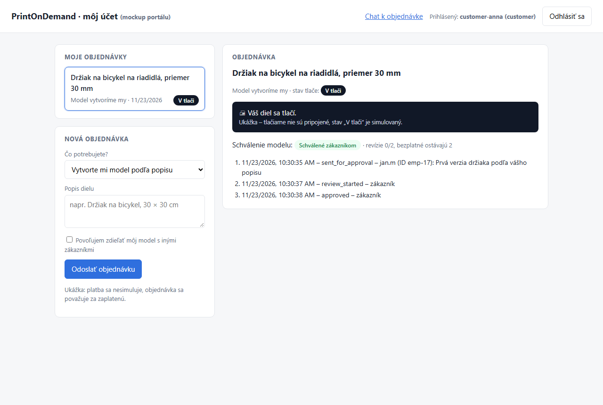
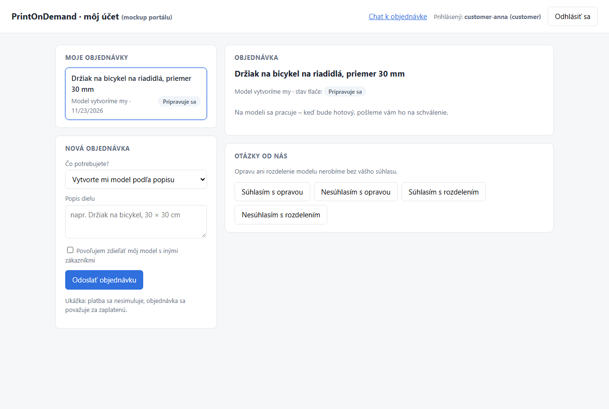
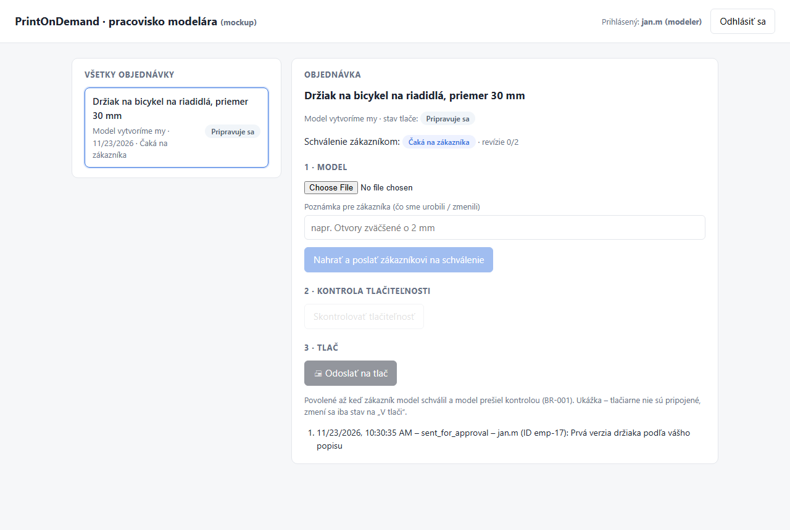
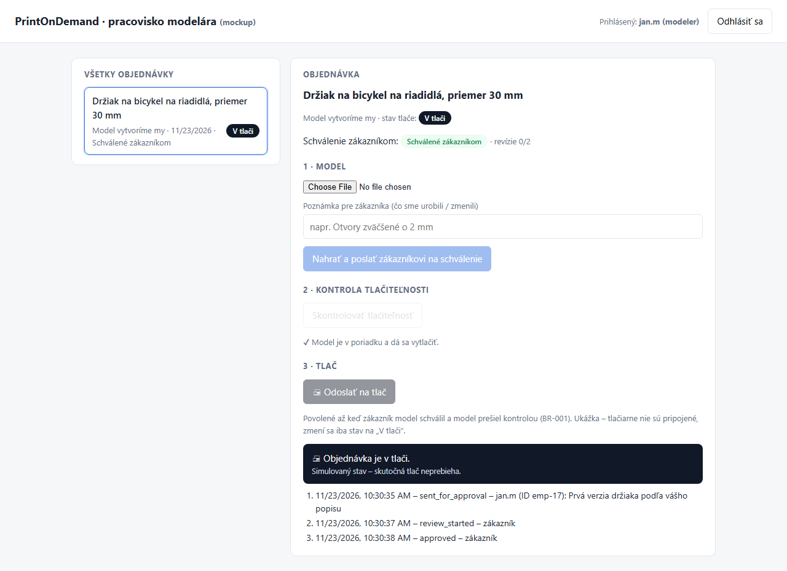

# Demo – od objednávky po tlač (mockup)

Ukážka funkcionality **R-001 „3D model approval (2 free revisions)“** pre
PrintOnDemand. Zákazník pošle objednávku, 3D modelár mu pošle model na
schválenie, zákazník ho schváli, modelár ho skontroluje a odošle na tlač.

> **Toto je mockup.** Stránky portálu sú jednoduché ukážkové stránky.
> Backend (API, pravidlá, databáza, prihlásenie) je skutočný a pokrytý testami,
> ale **3D tlačiarne nie sú pripojené** – tlačidlo „Odoslať na tlač“ iba zmení
> stav objednávky na „V tlači“. Platba, slicer, e-mail a SMS sa nesimulujú,
> validátor modelu je zástupný (stub).



## Čo ukážka predvádza

| Pravidlo | Čo uvidíte |
|---|---|
| Prihlásenie loginom a heslom, relácia 8 h v HttpOnly cookie (QR-002) | prihlasovacia stránka, „Odhlásiť sa“; zákazník a modelár majú každý svoju stránku |
| Zákazník vidí iba svoje objednávky | zoznam „Moje objednávky“; modelár vidí všetky |
| Do tlače ide iba model so súhlasom zákazníka (PRIN-001, BR-001) | „Odoslať na tlač“ je zablokované, kým zákazník model neschváli a model neprejde kontrolou |
| O schválení rozhoduje iba zákazník (BR-003) | tlačidlá „Súhlasím / Nesúhlasím“ má iba zákazník |
| Nesúhlas vždy s komentárom, 2 bezplatné revízie (BR-002, BR-003) | komentár v histórii, počítadlo „revízie x/2“ |
| Zákazník vidí ID a prezývku zamestnanca, nie celé meno (QR-001) | v histórii „jan.m (ID emp-17)“ |

## Spustenie

Potrebné: Docker Desktop (zapnutý), Python 3.12, Git Bash. Príkazy sa spúšťajú
z koreňa repozitára.

```bash
# 1. prvýkrát – inštalácia
python -m venv .venv
.venv/Scripts/pip install -e ".[test]"

# 2. databáza
docker compose up -d

# 3. čistý štart ukážky – POZOR: vymaže vývojovú databázu a vytvorí účty
PYTHONPATH=src .venv/Scripts/python -m pod.demo

# 4. server (nechaj bežať)
PYTHONPATH=src .venv/Scripts/uvicorn pod.main:create_app --factory
```

Potom otvor **http://127.0.0.1:8000/portal/**.

Tip: zákazníka a modelára otvor v **dvoch rôznych prehliadačoch** (alebo jedno
okno v režime inkognito) – každý má vlastné prihlásenie a môžeš medzi nimi
prepínať bez odhlasovania.

## Účty

| Login | Heslo | Rola | Po prihlásení |
|---|---|---|---|
| `anna` | `Anna-heslo-1` | zákazník | Moje objednávky |
| `boris` | `Boris-heslo-1` | zákazník | Moje objednávky |
| `jan.m` | `Jan-heslo-1` | 3D modelár | Pracovisko modelára |
| `eva.k` | `Eva-heslo-1` | manažér | Pracovisko modelára |

## Scenár ukážky (cca 4 minúty)

### 1. Zákazník pošle objednávku – `anna`

1. Prihlás sa ako **anna**. (Najprv môžeš ukázať zlé heslo → „Nesprávny login alebo heslo.“)
2. V časti **Nová objednávka** nechaj „Vytvorte mi model podľa popisu“, napíš popis,
   napr. *Držiak na bicykel na riadidlá, priemer 30 mm*, a klikni **Odoslať objednávku**.
3. Objednávka sa objaví v zozname **Moje objednávky** so stavom *Pripravuje sa*.



### 2. Modelár pošle model na schválenie – `jan.m`

1. V druhom prehliadači sa prihlás ako **jan.m** → otvorí sa **Pracovisko modelára**
   so všetkými objednávkami.
2. Vyber Anninu objednávku. V kroku **1 · Model** vyber ľubovoľný súbor (napr. `.stl`;
   ak nevyberieš nič, pošle sa ukážkový model), napíš poznámku a klikni
   **Nahrať a poslať zákazníkovi na schválenie** → stav *Čaká na zákazníka*.
3. Tlačidlo **Odoslať na tlač** je zatiaľ sivé – bez súhlasu zákazníka sa netlačí.



### 3. Zákazník model schváli – `anna`

1. Obnov stránku (F5) a vyber objednávku.
2. **Otvoriť model** → stav *Zákazník posudzuje* (modelár vidí, že si ho pozrel).
3. **Súhlasím s modelom** → *Schválené zákazníkom*.
   *(Alebo napíš komentár a klikni **Nesúhlasím** – modelár potom pošle novú revíziu
   tým istým tlačidlom v kroku 1.)*

### 4. Modelár skontroluje a odošle na tlač – `jan.m`

1. Obnov stránku (F5).
2. **2 · Skontrolovať tlačiteľnosť** → „Model je v poriadku a dá sa vytlačiť“,
   stav *Pripravené na tlač*.
3. **3 · 🖨 Odoslať na tlač** → stav **V tlači**.



### 5. Zákazník vidí, že sa diel tlačí – `anna`

Obnov stránku (F5) – objednávka má stav **V tlači** a oznam „Váš diel sa tlačí“
s poznámkou, že ide o simuláciu.

### Doplnky

- **Chat k objednávke** (odkaz vpravo hore u zákazníka) – iba vizuálny mockup,
  odpovede sú simulované.
- **API** pre technické publikum: `/api/customer_portal/docs`, `/api/order_orchestrator/docs`,
  `/api/modeling_workspace/docs`, `/api/model_repository/docs`, `/api/model_validator/docs`.
- **Chybný model**: súbor, ktorý obsahuje text `STUB:ERROR`, neprejde kontrolou
  tlačiteľnosti a vráti sa modelárovi na prepracovanie.

## Čo mockup nerobí

- Neprebieha skutočná tlač ani platba; „V tlači“ je iba stav objednávky.
- Nie je pripojený slicer, e-mail ani SMS; notifikácie sa ukladajú iba do účtu.
- Validátor je zástupný: chybu „nájde“ iba v súbore so značkou `STUB:ERROR`.
- Chat nemá backend.
- Registrácia účtu, 2FA a ochrana pred hádaním hesla nie sú v tejto verzii.

## Ak niečo nejde

| Problém | Riešenie |
|---|---|
| Stránka sa nenačíta | beží server z kroku 4? |
| Server visí alebo hlási chybu databázy | zapni Docker Desktop a spusti `docker compose up -d` |
| Druhá rola nevidí zmenu | obnov stránku (F5) – stránky sa samé neobnovujú |
| Chceš začať odznova | zastav server, spusti znova `python -m pod.demo` a server |

## Ďalšie podklady

- Všetky screenshoty celého scenára: [docs/screenshots/](../screenshots/)
- Specifikácia: [spec/](../../spec/), user stories [US-001](../../spec/stories/US-001.md), [US-002](../../spec/stories/US-002.md)
- Schválené contracts: [spec/contracts/approved/](../../spec/contracts/approved/)
